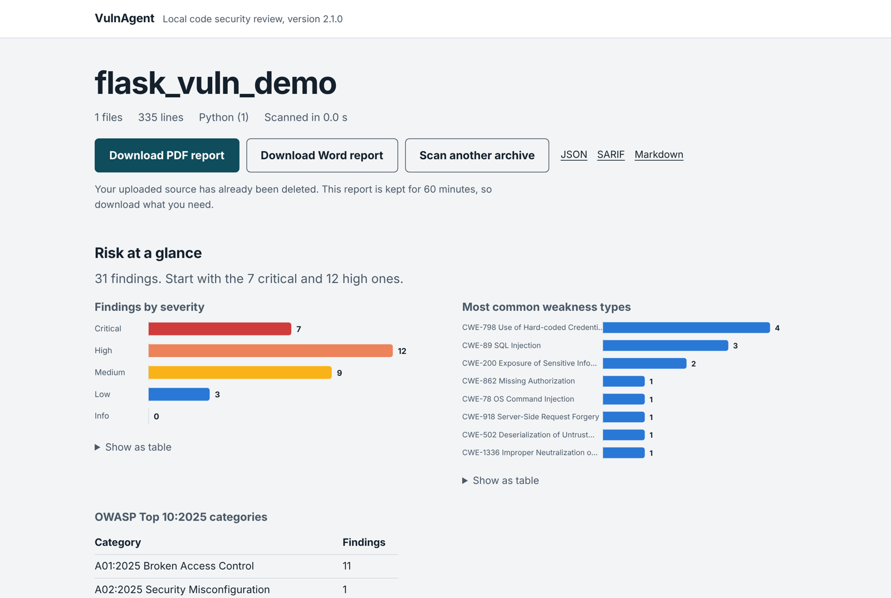
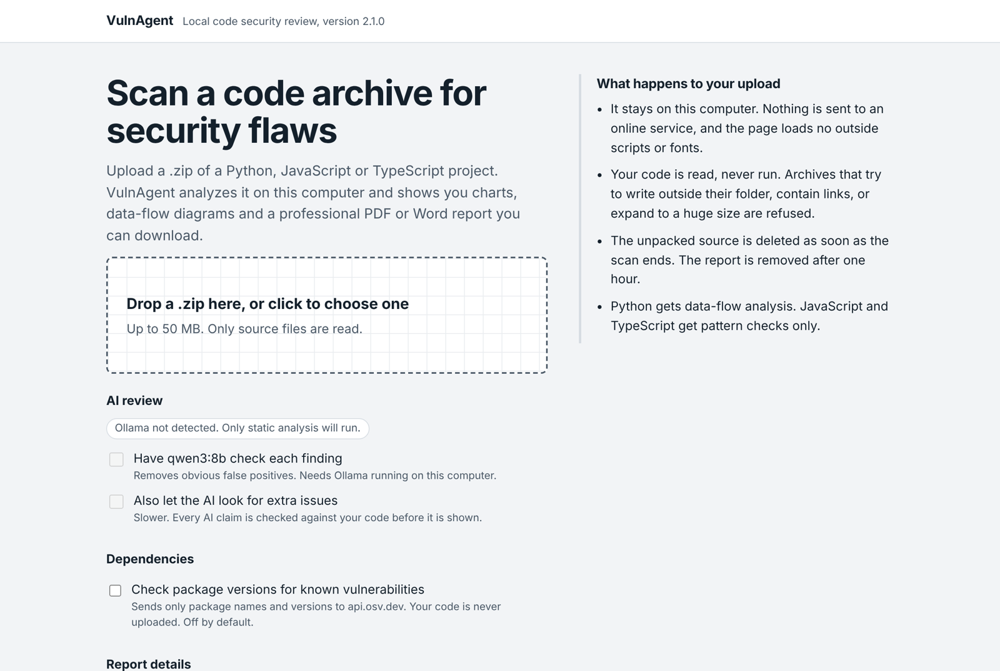
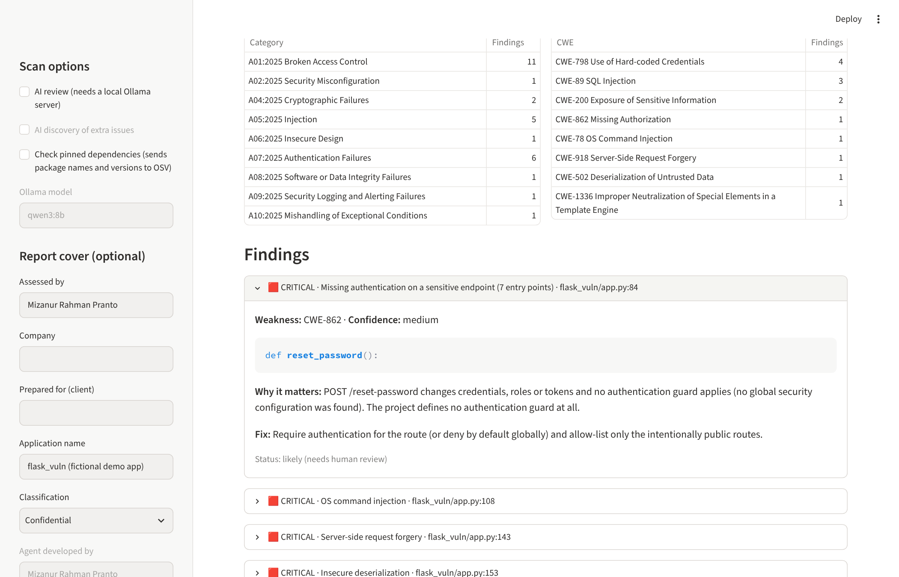
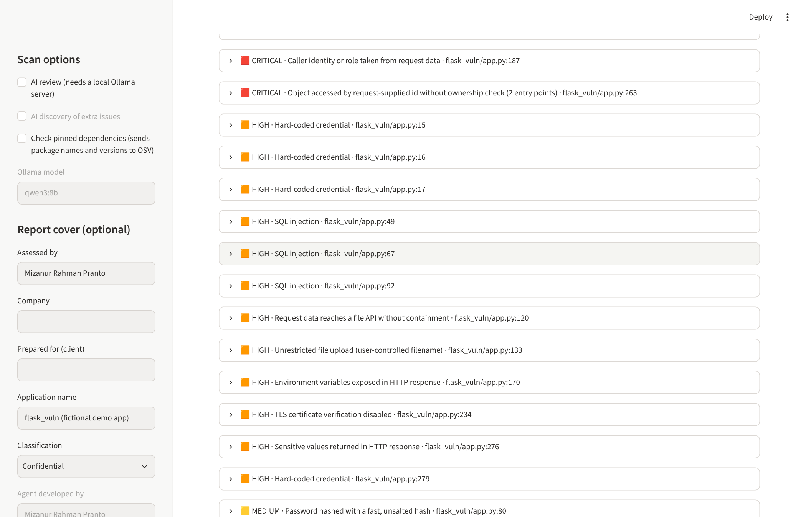
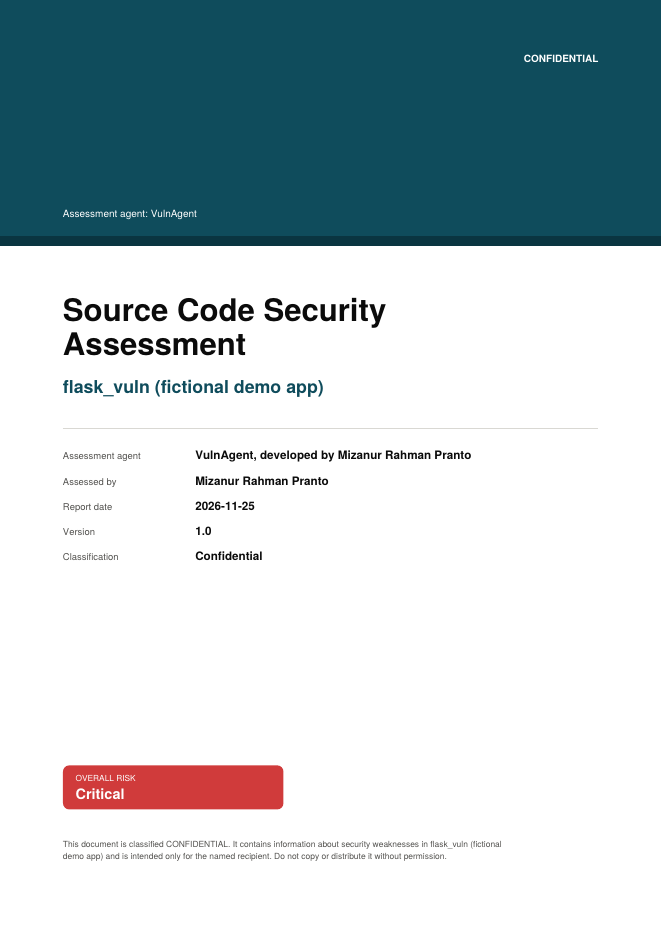
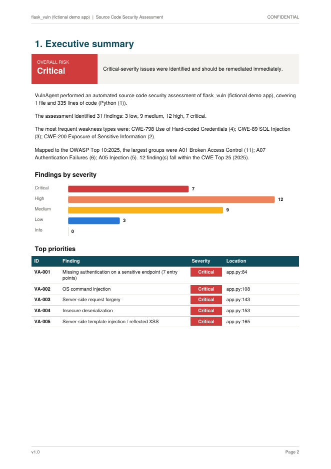
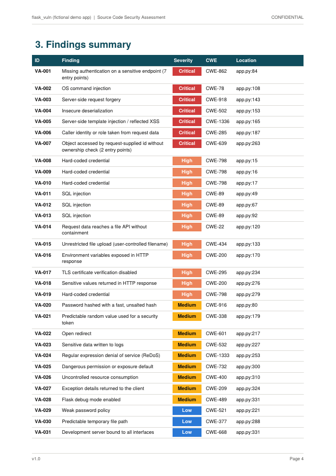
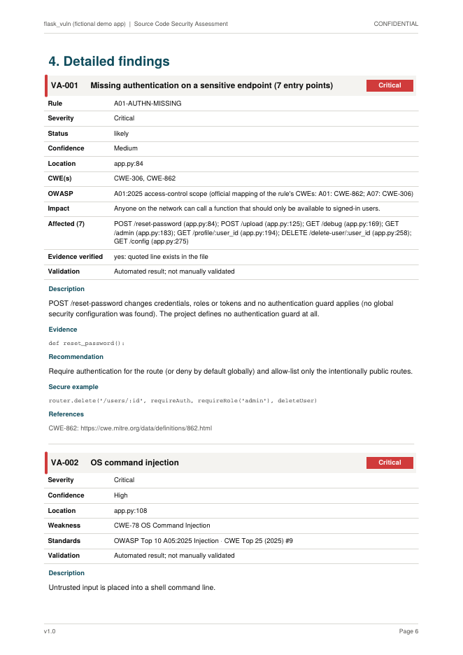
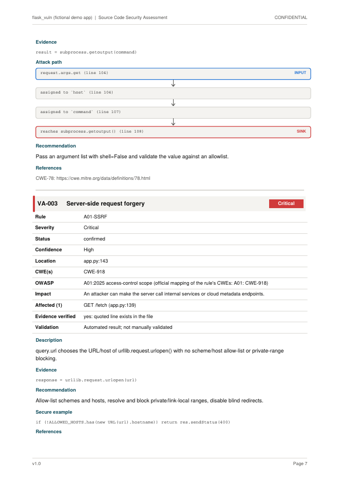

<p align="center"></p>

# VulnAgent

**A local source-code security scanner that shows its evidence.**
Upload a project, get a prioritised findings report mapped to the OWASP Top 10:2025. Your code never leaves your machine.


[Why](#why-vulnagent) · [Screenshots](#screenshots) · [Sample results](#results-sample-report) · [Highlights](#engineering-highlights) · [Coverage](#owasp-top-10-coverage) · [Quick start](#quick-start) · [Reports](#reports) · [Results](#measured-results) · [Roadmap](#roadmap) · [Limits](#known-limits) · [Contributing](CONTRIBUTING.md)

<p align="center">
  <a href="docs/img/ui-report.png"></a>
</p>

## Why VulnAgent

Most scanners make you choose: send your source code to a cloud service, or trust a pile of unexplained warnings. AI-based reviewers add a third problem, because a model will confidently describe code that is not there.

VulnAgent is built around three rules:

1. **Local first.** It runs on your machine. The optional AI stages talk only to your own [Ollama](https://ollama.com) server, so source code is never uploaded.
2. **Receipts, not claims.** Every AI statement must quote code that exists word for word in the file. Line numbers are recomputed, CWE ids are checked against a catalogue, and anything unverifiable is rejected and counted in the report.
3. **The model labels; it never deletes.** Dismissed findings stay in an appendix with the reason. Critical findings are never auto-dismissed, and files that contain prompt-injection text aimed at AI reviewers get no AI dismissals and are flagged as a finding themselves.

## Screenshots

All images come from real scans of the bundled `flask_vuln` test app (fictional, deliberately vulnerable code), with AI review switched off.

### Web app

| Upload page | Report page |
|---|---|
| [](docs/img/ui-home.png) | [](docs/img/ui-report.png) |

### Streamlit app (`streamlit run streamlit_app.py`)

| Options and results | Findings list |
|---|---|
| [](docs/img/streamlit-home.png) | [](docs/img/streamlit-findings.png) |

### PDF report ([open the full 28-page PDF](docs/sample-report.pdf))

| Cover | Executive summary | Findings summary |
|---|---|---|
| [](docs/sample-report.pdf) | [](docs/sample-report.pdf) | [](docs/sample-report.pdf) |

| Detailed finding | Attack path |
|---|---|
| [](docs/sample-report.pdf) | [](docs/sample-report.pdf) |

## Results (sample report)

Command: `python -m vulnagent benchmarks/targets/flask_vuln --no-llm --format pdf,md`. Files: [`docs/sample-report.pdf`](docs/sample-report.pdf) and [`docs/sample-report.md`](docs/sample-report.md).

**31 findings:** 7 critical, 12 high, 9 medium, 3 low. Overall risk rating: Critical. The seven critical findings:

| ID | Finding | CWE | Location |
|---|---|---|---|
| VA-001 | Missing authentication on a sensitive endpoint (7 entry points) | CWE-862 | `app.py:84` |
| VA-002 | OS command injection | CWE-78 | `app.py:108` |
| VA-003 | Server-side request forgery | CWE-918 | `app.py:143` |
| VA-004 | Insecure deserialization | CWE-502 | `app.py:153` |
| VA-005 | Server-side template injection / reflected XSS | CWE-1336 | `app.py:165` |
| VA-006 | Caller identity or role taken from request data | CWE-285 | `app.py:187` |
| VA-007 | Object accessed by request-supplied id without ownership check (2 entry points) | CWE-639 | `app.py:263` |

Findings by OWASP Top 10:2025 category:

| Category | Findings |
|---|---|
| A01 Broken Access Control | 11 |
| A07 Authentication Failures | 6 |
| A05 Injection | 5 |
| A04 Cryptographic Failures | 2 |
| A02 Security Misconfiguration, A06 Insecure Design, A08 Integrity Failures, A09 Logging and Alerting, A10 Exceptional Conditions | 1 each |

> The sample app is fictional and deliberately vulnerable, and the detectors were developed against it, so this shows what the output looks like, not how accurate the tool is on real code. See [Measured results](#measured-results) for what is and is not measured.

## Engineering highlights

- **Deterministic first, AI second.** Static analysis finds issues with no model at all (Python AST taint analysis, JS/TS pattern rules, a model of who can reach what). The AI stages are optional and only add triage and discovery on top.
- **A language-neutral access-control model.** Instead of matching single lines, VulnAgent builds a model of every HTTP entry point, its ordered guard chain and the request fields it trusts, then runs 16 declarative rules on that model. Each rule is written once for every language.
- **One source of truth for classification.** CWE, OWASP category and base severity come from a registry file (`vulnagent/a01/rules.json`) and `vulnagent/standards.py`, copied from the official lists. Neither extractors nor the model choose them.
- **Honest about absence.** Findings based on something missing (a missing check) are never marked "confirmed", and unsupported languages are listed under limitations instead of silently reporting "no findings".
- **Safe to run on untrusted code.** Uploads are extracted with zip-slip, symlink, zip-bomb and encrypted-archive protection and are only parsed, never executed. The web app binds to `127.0.0.1`, checks Host and Origin, sets a strict content security policy, and deletes uploaded source as soon as the scan ends.
- **Tested and self-scanning.** 103 automated tests, including a fake Ollama server that exercises the AI plumbing and safety policy deterministically. CI runs on Python 3.10 to 3.13 and scans this repository with itself, uploading SARIF to GitHub code scanning.
- **Report-grade output.** PDF and Word reports with a cover page, executive summary, diagrams, an entry-point authorisation matrix and a coverage section, plus JSON, SARIF and Markdown.

```
source ─▶ Python AST taint analysis + JS/TS pattern rules ─▶ ┐
        └▶ access-control model: entry points · guards · data models ─▶ ├▶ dedupe ─▶ optional AI review ─▶ evidence grounding ─▶ report
          optional: Semgrep · OSV dependency check ─────────────────────▶ ┘
```

## OWASP Top 10 coverage

VulnAgent is adding the [OWASP Top 10:2025](https://top10.owasp.org/2025/) categories one by one. Every finding already carries its official category and, where applicable, its rank in MITRE's 2025 CWE Top 25. A category counts as done only when it has its own rules in the registry, a vulnerable and a safe fixture for each rule, and a benchmark on code the rules have never seen.

| # | Category | Where it stands |
|---|---|---|
| A01 | Broken Access Control | **Most complete.** 16 rules: missing authentication or authorisation, IDOR, identity taken from the request, privilege assignment, fail-open and mis-ordered guards, path traversal, SSRF, open redirect, CSRF, CORS, data exposure, insecure defaults, token and session mistakes. Python and JS/TS complete, Java and C# partial |
| A02 | Security Misconfiguration | Partial: debug mode; config-file scanning planned |
| A03 | Software Supply Chain Failures | Partial: known-vulnerable pinned packages via [OSV](https://osv.dev) (`--deps`) |
| A04 | Cryptographic Failures | Partial: weak hashes, predictable random values |
| A05 | Injection | Partial: SQL, command and template injection, XSS, code execution (Python taint analysis); JS/TS pattern rules |
| A06 | Insecure Design | Early: unrestricted file upload |
| A07 | Authentication Failures | Partial: hard-coded credentials, JWT verification |
| A08 | Software or Data Integrity Failures | Partial: unsafe deserialisation (Python) |
| A09 | Security Logging and Alerting Failures | Early: sensitive data in logs (Python) |
| A10 | Mishandling of Exceptional Conditions | Early: fail-open guards |

"Partial" and "early" mean some existing rules map to that category. They are not claims of full coverage. What is missing in each category and the build order: [docs/ROADMAP.md](docs/ROADMAP.md). Rule details and false-positive guards: [docs/RULES.md](docs/RULES.md).

### Languages and frameworks

| Language | Level | Frameworks |
|---|---|---|
| Python | complete | Flask, FastAPI, Django and DRF |
| JavaScript / TypeScript | complete | Express, Fastify, Koa, NestJS, Next.js API routes |
| Java | partial | Spring MVC / Security, JAX-RS |
| C# | partial | ASP.NET Core |
| PHP · Go · Ruby | **not analysed yet** | reported under limitations |

JS/TS, Java and C# analysis needs the optional parsers in `requirements-a01.txt`. Without them these languages are reported as "not analysed".

## Quick start

```bash
git clone https://github.com/mizanpranto/vulnagent.git
cd vulnagent
python3 -m venv .venv && source .venv/bin/activate
pip install -r requirements.txt
pip install -r requirements-a01.txt      # optional: JS/TS, Java, C# access-control analysis
python -m vulnagent serve                # web UI on http://127.0.0.1:8080
```

Prefer Streamlit? The same scanner, safe unzip and reports are available as a Streamlit app:

```bash
pip install -r requirements-streamlit.txt
streamlit run streamlit_app.py           # http://localhost:8501
```

Zip a project (or `benchmarks/targets/flask_vuln`), drop it on the upload page, and read the report. AI review is optional: install [Ollama](https://ollama.com) and run `ollama pull qwen3:8b`.

Command line:

```bash
python -m vulnagent project.zip --no-llm --format md,json,sarif,pdf,docx --fail-on high
python -m vulnagent path/ --discover --model qwen3:8b --exclude "tests/*"
python -m vulnagent path/ --public-path "^/status$"      # intentionally public routes
python -m vulnagent path/ --deps                         # also check pinned dependencies against OSV
```

`--fail-on high` makes the command exit non-zero when an active finding is at least that severity, so it can gate a CI pipeline. `--deps` sends only package names and versions to OSV and is the only part that uses the network.

## Reports

| Format | Use it for |
|---|---|
| **PDF** | A pentest-style report with cover page, executive summary, diagrams and appendices |
| **Word (.docx)** | The same content, editable, so a reviewer can add notes |
| **JSON** | Feeding other tools |
| **SARIF** | GitHub code scanning |
| **Markdown** | Pull request comments and plain-text review |

Cover details (assessor, company, client, application, classification, logo, version) are optional, in the web form or with flags such as `--assessor` and `--client`.

> Output is an **automated** result. Every finding says it has not been manually validated until a person reviews it. VulnAgent supports a qualified reviewer and does not replace one; it is not a penetration test or a certification.

## Measured results

Static analysis only (no AI), reproducible with `python -m vulnagent.bench`:

| Target | Result | Note |
|---|---|---|
| `flask_vuln` (30 labelled issues, my own test app) | recall 30/30, precision 31/31 | **Regression test only**; the detectors were developed against it |
| `flask_clean` | 0 false positives | Before the access-control layer it had 1 |
| [we45/Vulnerable-Flask-App](https://github.com/we45/Vulnerable-Flask-App) (third party, 15 labels) | 11/15 before the access-control layer | **Not re-run since.** The first held-out run was 7/15 |

**Not yet measured:** access-control recall and precision on third-party apps (Juice Shop, NodeGoat, DVNA, WebGoat, DVWA, VAmPI, django.nV) and on clean apps, and real `qwen3:8b` triage quality. The tests use a deterministic fake Ollama server, which proves plumbing and safety policy, not model accuracy. The numbers above show regression coverage, not accuracy on real-world code.

## Roadmap

1. **Foundation.** Move all rules into the registry, scan configuration and CI files, add per-rule vulnerable and safe fixtures.
2. **Finish A01.** Per-rule fixtures, a third-party benchmark, Java and C# completion, then PHP, Go and Ruby.
3. **The remaining categories, one by one.** Planned order: A04, A10, A05, A02, A07, A08, A03, A09, A06.
4. **Cross-function taint tracking** and a benchmark of several local models for triage quality.

The reasoning behind the order is in [docs/ROADMAP.md](docs/ROADMAP.md).

## Known limits

- Taint tracking is intra-procedural: no cross-function data flow, limited ORM models.
- The access-control model is static: authentication enforced by a proxy or gateway is invisible, and authorisation inside a helper the extractor cannot resolve can cause IDOR false positives. Only HTTP entry points are modelled (no GraphQL, queues or jobs).
- Absence-based findings need human review. Severity is a qualitative rating, not CVSS.
- The PDF uses built-in fonts, so characters outside Latin-1 print as "?" (the Word report keeps them).
- A small local model will miss things and is sometimes wrong, which is why every AI claim must be grounded in the source.

## Project layout

```
vulnagent/
├── vulnagent/            scanner, taint analysis, pipeline, reports
│   ├── a01/              access-control model: ir, extractors/, engine, rules.json
│   └── web/              Flask app, templates, static files
├── docs/                 RULES.md, ROADMAP.md, sample report, screenshots (img/)
├── benchmarks/           labelled test apps and expected results
├── test-project/         small deliberately vulnerable app
├── tests/                pytest suite with a fake Ollama server
├── streamlit_app.py      optional Streamlit front end
├── requirements*.txt  pyproject.toml  CONTRIBUTING.md  LICENSE
```

## Contributing

Anyone can help, including by taking a whole OWASP category from the roadmap. Open an issue first so two people do not build the same one, then follow [CONTRIBUTING.md](CONTRIBUTING.md). The access-control layer in `vulnagent/a01/` is the template to copy. Also welcome: framework extractors (Rails, Laravel, Gin, Echo), benchmark labels for third-party apps, and false-positive reports as minimal reproductions.

## Author

Built and maintained by **Mizanur Rahman Pranto** ([@mizanpranto](https://github.com/mizanpranto)). Questions, feedback and pull requests are welcome through GitHub issues.

## Licence

MIT. See [LICENSE](LICENSE). `test-project/` and `benchmarks/targets/` contain deliberately vulnerable code for testing; do not deploy them.
